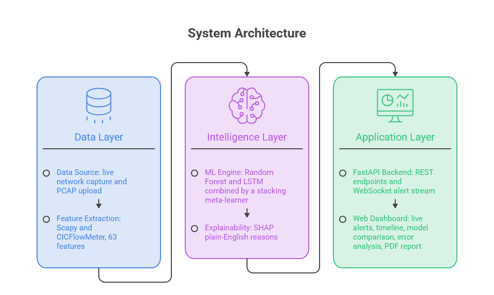
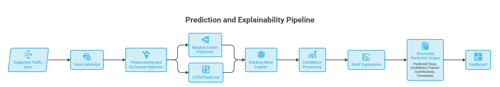
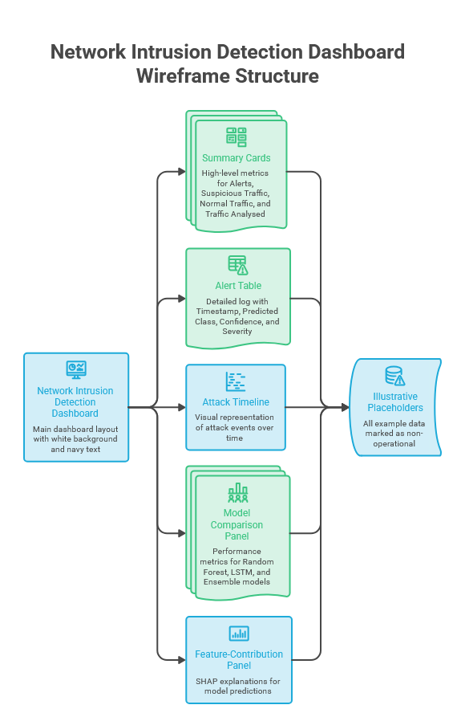
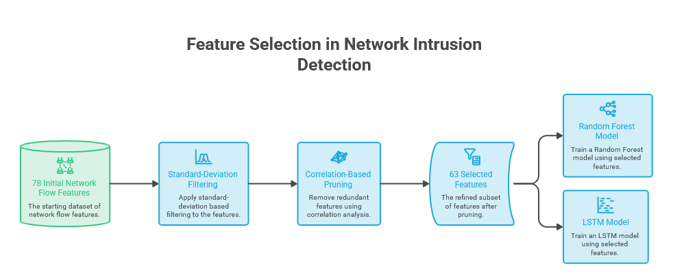
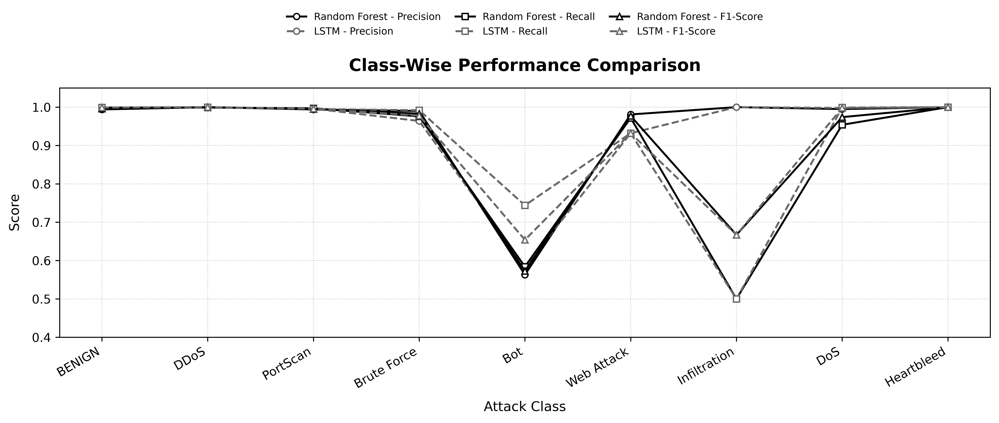

# AI-Powered Network Intrusion Detection System

**Developed by:** Jithesh Shetty, Siddhant Sinha, and Srijan Sundaram

An explainable network intrusion detection system that analyzes live network traffic and uploaded PCAP files, classifies network flows into nine traffic classes, and presents detection results through a browser-based dashboard.

This project was developed as a final-year B.Tech project at **Bharati Vidyapeeth (Deemed to be University), Department of Engineering and Technology, Navi Mumbai**.

> **Project Status:** The backend and dashboard are implemented. The project is intended for academic demonstration and evaluation and is **not being deployed**.

---

## Features

- **Automatic live traffic capture:** Captures traffic from the network interface used by the connected system, such as Wi-Fi. Users do not need to select or enter an interface manually.
- **PCAP analysis:** Upload and replay `.pcap` and `.pcapng` files for analysis.
- **Nine-class detection:** Classifies traffic as BENIGN, DDoS, Port Scan, Brute Force, Bot, Web Attack, Infiltration, DoS, or Heartbleed.
- **Random Forest + LSTM ensemble:** Combines model predictions using weighted soft voting.
- **Explainable predictions:** Uses SHAP feature contributions to derive plain-English reasons for alerts.
- **Real-time dashboard:** Displays traffic metrics, a detailed alert log, attack activity over time, model performance, and session reports.
- **Dynamic world map:** Remains static during normal traffic and displays an alert when an attack is detected.
- **PDF report export:** Generates a report for the current session.
- **FastAPI backend:** Provides REST endpoints and a WebSocket stream for live alerts.

---

## System Architecture

The system captures live network traffic or accepts a PCAP file, extracts network-flow features, performs model inference, and sends detection results to the dashboard through the FastAPI backend.



### Prediction and Explainability Pipeline



### Dashboard Overview

The dashboard focuses on high-level traffic metrics, detailed alert logs, attack activity over time, model performance, and a dynamic world map that highlights detected attacks.

The Model Comparison, Error Analysis, and dedicated Explainability tabs from the earlier design have been removed from the current dashboard.



---

## Detection Classes

| Class | Description |
|---|---|
| BENIGN | Normal network traffic |
| DDoS | Distributed denial-of-service traffic |
| Port Scan | Traffic associated with port scanning |
| Brute Force | Repeated attempts to guess credentials |
| Bot | Traffic classified as bot-related |
| Web Attack | Web-based attack traffic |
| Infiltration | Infiltration-related traffic |
| DoS | Denial-of-service traffic |
| Heartbleed | Heartbleed-related traffic |

---

## Model Configuration

| Component | Configuration |
|---|---|
| Dataset | CICIDS-2017 |
| Input features | 32 selected flow features, scaled to `float32` |
| Number of classes | 9 |
| Random Forest | 100 trees, controlled random oversampling (RF-3) |
| LSTM | 1 layer, 64 hidden units, window of 10 flows, controlled sequence oversampling (LSTM-3) |
| Ensemble | Weighted soft voting |
| Ensemble formula | `P = 0.75 × P_RF + 0.25 × P_LSTM` |
| Output | Nine-class probability vector; confidence is uncalibrated |

Feature selection uses standard-deviation-based filtering followed by correlation analysis to reduce redundant features before model training.



---

## Evaluation Results

The following overall scores are taken from the project's updated model evaluation results.

### Overall Model Performance

| Model | Accuracy | Precision | Recall | F1-Score | False-Positive Rate (FPR) |
|---|---:|---:|---:|---:|---:|
| Random Forest | 99.43% | 0.890 | 0.887 | 0.907 | 2.360% |
| LSTM | 99.84% | 0.941 | 0.907 | **0.914** | 0.119% |
| Ensemble | 99.80% | **0.950** | 0.831 | 0.866 | **0.114%** |

The LSTM achieves the highest reported accuracy and F1-score. The ensemble achieves the highest precision and lowest reported false-positive rate. However, the ensemble does not outperform both individual models across all metrics.

### Random Forest: Class-Wise Performance

| Attack Class | Precision | Recall | F1-Score | Samples |
|---|---:|---:|---:|---:|
| BENIGN | 0.994 | 0.999 | 0.996 | 455,399 |
| DDoS | 1.000 | 0.999 | 1.000 | 25,601 |
| PortScan | 0.994 | 0.997 | 0.995 | 31,946 |
| Brute Force | 0.990 | 0.976 | 0.983 | 2,648 |
| Bot | 0.563 | 0.584 | 0.573 | 399 |
| Web Attack | 0.981 | 0.972 | 0.977 | 428 |
| Infiltration | 1.000 | 0.500 | 0.667 | 8 |
| DoS | 0.995 | 0.954 | 0.974 | 49,080 |
| Heartbleed | 1.000 | 1.000 | 1.000 | 1 |

### LSTM: Class-Wise Performance

| Attack Class | Precision | Recall | F1-Score | Samples |
|---|---:|---:|---:|---:|
| BENIGN | 0.999 | 0.999 | 0.999 | 455,390 |
| DDoS | 1.000 | 1.000 | 1.000 | 25,601 |
| PortScan | 0.996 | 0.995 | 0.996 | 31,946 |
| Brute Force | 0.964 | 0.992 | 0.978 | 2,648 |
| Bot | 0.584 | 0.744 | 0.654 | 399 |
| Web Attack | 0.932 | 0.932 | 0.932 | 428 |
| Infiltration | 1.000 | 0.500 | 0.667 | 8 |
| DoS | 0.998 | 0.999 | 0.998 | 49,080 |
| Heartbleed | 1.000 | 1.000 | 1.000 | 1 |

### Ensemble: Class-Wise Performance

| Attack Class | Precision | Recall | F1-Score | Samples |
|---|---:|---:|---:|---:|
| BENIGN | 0.999 | 0.999 | 0.999 | 369,492 |
| DDoS | 1.000 | 1.000 | 1.000 | 20,458 |
| PortScan | 0.994 | 0.999 | 0.997 | 25,261 |
| Brute Force | 0.995 | 0.994 | 0.994 | 1,862 |
| Bot | 0.578 | 0.623 | 0.600 | 297 |
| Web Attack | 0.992 | 0.992 | 0.992 | 363 |
| Infiltration | 1.000 | 0.385 | 0.556 | 13 |
| DoS | 0.996 | 0.990 | 0.993 | 33,456 |
| Heartbleed | 1.000 | 0.500 | 0.667 | 4 |



**Interpreting the results:** Bot detection remains challenging across all three models. Infiltration and Heartbleed have extremely small sample counts, so their reported metrics should not be treated as strong evidence of generalization to these attacks.

---

## Repository Structure

```text
AI-Network-Intrusion-Detection-System/
├── backend/        FastAPI application, capture, replay, inference
├── dashboard/      Browser dashboard (HTML, CSS, JavaScript)
├── models/         Trained model artifacts (Git LFS)
├── notebooks/      Data preparation, training, SHAP and evaluation
├── assets/         Project diagrams and performance visualization
├── .gitattributes
├── .gitignore
└── README.md
```

---

## Prerequisites

- Python 3.10 or later
- Git and Git LFS
- Windows: [Npcap](https://npcap.com/) for live packet capture
- A modern web browser
- Internet access for dashboard libraries loaded from a CDN, including Plotly and jsPDF

---

## Installation and Setup

The following instructions use PowerShell on Windows.

### 1. Clone the repository

```powershell
git clone https://github.com/srijansundaram/AI-Network-Intrusion-Detection-System.git
cd AI-Network-Intrusion-Detection-System
```

### 2. Download model files

```powershell
git lfs install
git lfs pull
```

### 3. Set up the Python environment

```powershell
cd backend
python -m venv venv
.\venv\Scripts\Activate.ps1
pip install -r requirements.txt
```

If PowerShell blocks virtual-environment activation, use an appropriate local execution-policy setting or activate the environment through Command Prompt using `venv\Scripts\activate.bat`.

---

## Running the Project

Start the backend and dashboard in two separate terminals.

### Terminal 1: Start the backend

```powershell
cd backend
.\venv\Scripts\Activate.ps1
uvicorn app.main:app --host 0.0.0.0 --port 8000
```

### Terminal 2: Start the dashboard

```powershell
cd dashboard
python -m http.server 3000
```

Open the dashboard in your browser:

**http://localhost:3000**

Other useful endpoints:

- API documentation: http://localhost:8000/docs
- Health check: http://localhost:8000/health

For live packet capture on Windows, install Npcap and run the backend with the permissions required by the capture setup. The application is designed to select the active connected network interface automatically, so users do not need to enter an interface name manually.

---

## API Overview

| Method | Endpoint | Purpose |
|---|---|---|
| `POST` | `/api/capture/start` | Start live packet capture |
| `POST` | `/api/capture/stop` | Stop live packet capture |
| `GET` | `/api/capture/status` | Check capture status |
| `POST` | `/api/replay/start` | Replay a saved PCAP as simulated live traffic |
| `POST` | `/api/replay/stop` | Stop replay |
| `POST` | `/api/upload` | Upload a `.pcap` or `.pcapng` file for analysis |
| `GET` | `/api/metrics` | Retrieve latency and throughput metrics |
| `WS` | `/ws/alerts` | Receive the live alert stream |
| `GET` | `/health` | Check service health and model-loaded status |

---

## Troubleshooting

### No alerts appear in the dashboard

Check the packet capture status:

```powershell
Invoke-RestMethod http://localhost:8000/api/capture/status
```

If capture is not running, try starting it:

```powershell
Invoke-RestMethod -Uri "http://localhost:8000/api/capture/start" `
  -Method Post `
  -ContentType "application/json" `
  -Body '{}'
```

### Common Issues

| Problem | What to check |
|---|---|
| Live capture fails on Windows | Confirm Npcap is installed and the backend has the required permissions |
| Dashboard displays demo data | Check whether `USE_MOCK` is still `true` in `dashboard/api.js`; set it to `false` for the real backend |
| Browser reports a CORS error | Ensure the backend allows the dashboard origin, `http://localhost:3000` |
| Dashboard cannot reach the backend | Confirm the backend is running on port 8000 and `API.BASE` in `dashboard/api.js` is correct |
| Model files fail to load or are unusually small | Run `git lfs pull`; the files may be Git LFS pointers |
| Charts or PDF export fail | Check the internet connection for Plotly and jsPDF CDN scripts |

---

## Limitations

- **Uncalibrated confidence:** Displayed confidence represents the highest predicted class probability. It should not be interpreted as a calibrated probability of an attack.
- **Ensemble trade-offs:** The ensemble does not outperform every individual model on all reported metrics. Results are reported as measured.
- **Rare-class uncertainty:** The evaluation includes very few Infiltration and Heartbleed samples, limiting confidence in those class-specific results.
- **Bot detection:** The reported F1-scores are 0.573 for Random Forest, 0.654 for LSTM, and 0.600 for the ensemble.
- **LSTM sequence assumptions:** The flow windows have not been verified as continuous network sessions. The LSTM should not be described as a session-aware detector.
- **Class grouping:** The nine labels combine related CICIDS-2017 attack families, including DoS variants.
- **Generalization and robustness:** Cross-dataset generalization and adversarial robustness have not been evaluated.
- **Academic prototype:** The system is intended for local demonstration and academic evaluation. It is not being deployed and should not be treated as a production security control.

---

## Team

| Member | Responsibility |
|---|---|
| **Jithesh Shetty — Member A** | Data preparation, feature selection, model training, evaluation, and SHAP analysis. |
| **Siddhant Sinha — Member B** | FastAPI backend, automatic live traffic capture, PCAP upload and replay, and inference. |
| **Srijan Sundaram — Member C** | Dashboard development, dynamic world map, alert presentation, and PDF report export. |

---

## References

1. D. Suja Mary et al., “Network intrusion detection: An optimized deep learning approach using big data analytics,” *Expert Systems with Applications*, vol. 251, 2024.
2. L. Zhang et al., “A data-driven network intrusion detection system using feature selection and deep learning,” *Journal of Information Security and Applications*, vol. 77, 2023.
3. F. Nabi and X. Zhou, “Enhancing intrusion detection systems through dimensionality reduction,” *Cyber Security and Applications*, vol. 2, 2024.
